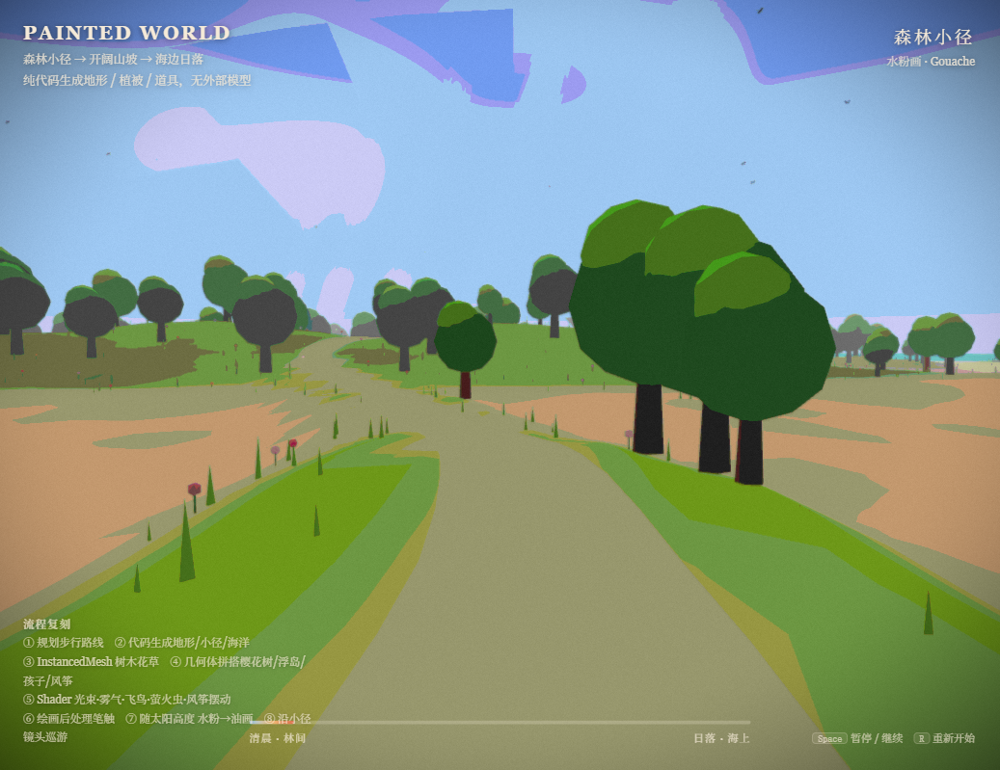
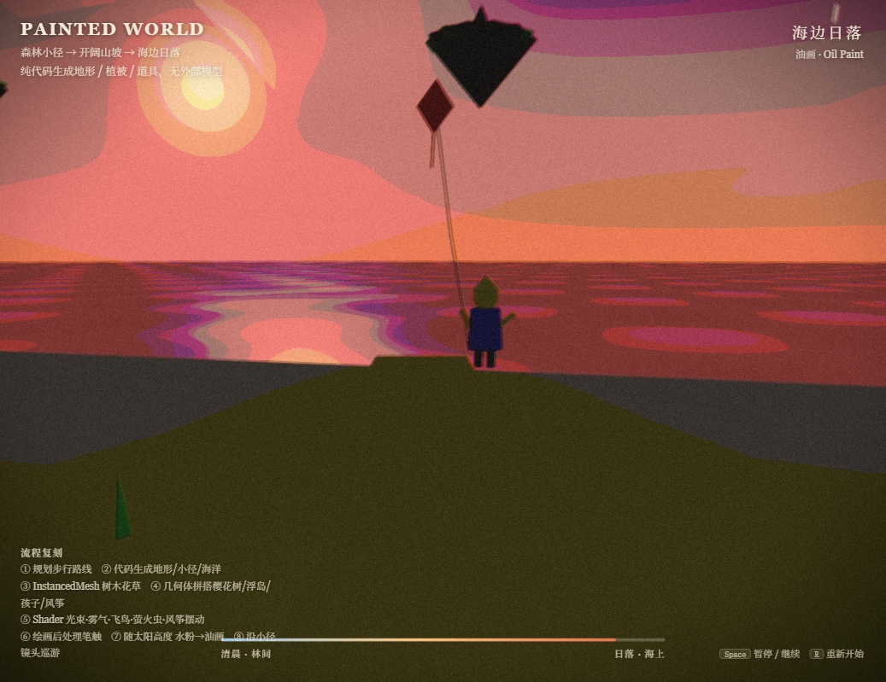

<div align="center">

# Painted World

**A code-only 3D world where gouache slowly turns into oil paint as the sun goes down.**

Walk a forest path → cross an open hill → reach a sunset over the sea.
Everything — terrain, trees, grass, props — is generated by code. Zero external models.

**[English](README.md) · [简体中文](README.zh-CN.md)**


</div>

## Preview

| Forest path · Gouache | Sunset over the sea · Oil paint |
| --- | --- |
|  |  |

## What it does

- **One continuous walk, 90 seconds.** A `CatmullRomCurve3` drives the camera from a dense forest trail, up over a hill, down to the shoreline while the sun descends from about 52° to 7°.
- **Two media, one slider.** `uDay` interpolates between day and dusk and drives sky, sea, fog, light intensity *and* the brush parameters of the post-processing pass, so the look slides from dry gouache to thick oil paint.
- **No assets.** Terrain is fbm noise, the path is a ribbon mesh laid on that height field, the sea is a custom shader, and trees / grass / flowers are instanced meshes. The only dependency is `three.min.js`.
- **Everything in one file.** Scene, shaders, UI and post-processing live in `index.html`.

## Run it

```bash
git clone https://github.com/scat2020/painted-world.git
cd painted-world
```

Then **double-click `index.html`** — no server, no build step, no network. `three.min.js` is bundled locally and loaded with a relative path.

If your browser blocks `file://` pages, serve the folder over HTTP instead:

```bash
python -m http.server 8123
# then open http://127.0.0.1:8123/index.html
```

### Controls

| Key | Action |
| --- | --- |
| `Space` | pause / resume the walk |
| `R` | restart from the beginning |

## How it works

| # | Step | Implementation |
| --- | --- | --- |
| ① | Plan the route: forest path → open hill → sunset over the sea | `CatmullRomCurve3` with three stitched segments; camera sampled along the curve |
| ② | Generate terrain / path / sea in code, no models | fbm-noise height field (hill in the middle, shoreline dropping to the sea, flattened along the route) + ribbon path mesh + custom sea shader |
| ③ | Instanced trees / grass / flowers | `InstancedMesh` broadleaf trees (trunk + shaded crown + lit crown), grass blades, flowers with per-instance colours |
| ④ | Hero props from primitives | cherry tree (sphere clusters), three floating islands (inverted rock cones + grass cap), a child (cylinder / sphere / cone), a kite with a tail |
| ⑤ | Custom shaders: god rays, fog, birds, fireflies, kite string | additive light shafts, ground fog, circling birds with flapping wings, dusk fireflies, kite string re-computed every frame |
| ⑥ | Per-frame painting pass | scene → `WebGLRenderTarget` → full-screen quad that applies brush quantisation, stroke direction, smear, grain and warm grade |
| ⑦ | Brush style bound to sun height | `uDay` from 1 (gouache) to 0 (oil) drives brush shape, palette and contrast |
| ⑧ | Camera walks, sun sets | camera follows the curve; sun elevation drops from about 52° to 7°, and sky / sea / lighting follow |

## Project structure

```text
painted-world/
├── index.html            # scene, shaders, UI, post-processing (single file)
├── three.min.js          # three.js r160 UMD, must sit next to index.html
├── preview-forest.png    # screenshot · forest stage
├── preview-sunset.png    # screenshot · sunset stage
├── README.md             # this file (English)
├── README.zh-CN.md       # Chinese README
└── reference/            # comparison material, not needed at runtime
    ├── painted.mp4       # 28 s reference film this scene was matched against
    ├── original.mp4      # unrelated video attached to the same post
    ├── frames_p/         # per-second frames of the reference film
    ├── frames/           # frames of the unrelated video
    ├── psheet1.jpg       # contact sheet, 1–15 s
    ├── psheet2.jpg       # contact sheet, 16–28 s
    └── *.py, tweet.json  # frame / colour sampling scripts and post metadata
```

## Reference material

`reference/` holds the film this scene was matched against, frame by frame: the 28 s / 1920×1080 video from the original post, its extracted frames and contact sheets. Nothing in `reference/` is loaded at runtime — you can delete that folder and the demo still runs; `index.html` + `three.min.js` are all it needs.

## Known limitations

- Procedural colour grading still differs from the film in places: some ground patches read tan instead of lime, tree crowns are rounder and the canopy thinner than the reference.
- Floating-island rock reads dark at dusk; the sun glitter band on the sea is a little wider than in the film.
- Desktop only — no touch controls.
- Verified in Chromium: page loads with 0 errors and one benign notice (the r160 UMD build is flagged as deprecated; UMD is kept on purpose so `index.html` can run from `file://`).

## Credits

Scene recreated from the demo posted by [@rewind02](https://x.com/rewind02/status/2122298720955830563). Built with [three.js](https://threejs.org/). The code here is an original procedural reconstruction; the video and frames in `reference/` belong to their author and are included for comparison only.
