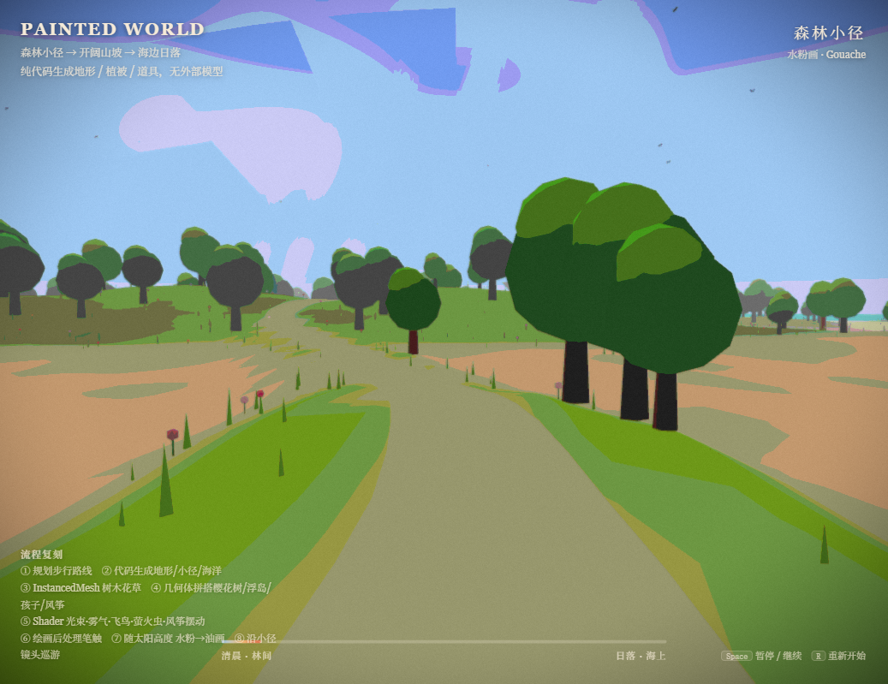
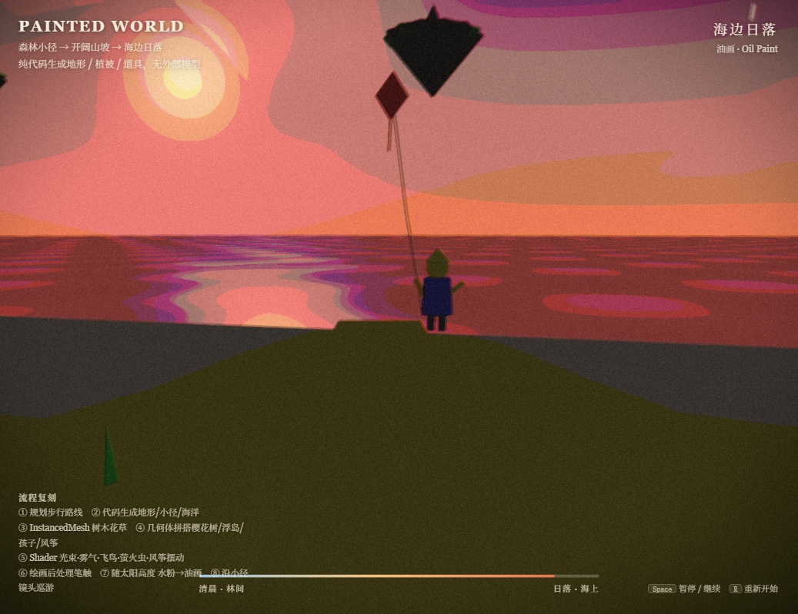

<div align="center">

# 绘画世界 · Painted World

**纯代码生成的 3D 世界：太阳落山，画面从水粉画慢慢变成油画。**

森林小径 → 开阔山坡 → 海边日落。地形、树木、草花、道具全部由代码生成，**不使用任何外部模型**。

**[English](README.md) · [简体中文](README.zh-CN.md)**


</div>

## 画面预览

| 森林小径 · 水粉画 | 海边日落 · 油画 |
| --- | --- |
|  |  |

## 它做了什么

- **一次连续巡游，90 秒走完。**`CatmullRomCurve3` 驱动相机，从密林小径上坡、翻过山脊、下到海边，同时太阳高度角由约 52° 降到约 7°。
- **两种绘画质感，一个统一参数。**`uDay` 在白天与暮色之间插值，同时驱动天空、海洋、雾气、光照强度和后处理笔触，于是画面从干涩的水粉逐渐过渡为厚涂油画。
- **零素材依赖。**地形是 fbm 噪声，土路是压在地形上的 ribbon 网格，海洋与天空是自定义 Shader，树木草花走 `InstancedMesh`；唯一依赖是同目录的 `three.min.js`。
- **全部逻辑在一个文件里。**场景、Shader、界面、后处理都在 `index.html`。

## 运行

```bash
git clone https://github.com/scat2020/painted-world.git
cd painted-world
```

然后**双击 `index.html`** 即可：不需要服务器、不需要构建、不需要联网，`three.min.js` 已本地化并以相对路径引入。

如果浏览器拦截 `file://` 页面，可在本目录起一个静态服务：

```bash
python -m http.server 8123
# 然后打开 http://127.0.0.1:8123/index.html
```

### 操作

| 按键 | 作用 |
| --- | --- |
| `Space` | 暂停 / 继续巡游 |
| `R` | 从头开始 |

## 实现思路

| 步骤 | 原帖要求 | 本项目做法 |
| --- | --- | --- |
| ① | 规划路线：forest path → open hill → sunset over the sea | `CatmullRomCurve3` 三段拼接，相机沿曲线采样 |
| ② | 纯代码生成 terrain / path / sea，无模型 | fbm 噪声地形（中部山脊、海岸下沉、沿路压平）+ 土路 ribbon + 自定义海洋 Shader |
| ③ | InstancedMesh 程序化 trees / grass / flowers | 阔叶树（树干 + 暗部冠 + 受光冠）、草叶、多色花冠，全部实例化 |
| ④ | 基础几何体拼搭 hero props | 樱花树（球簇）、三座浮岛（倒锥岩石 + 草皮）、孩子（圆柱/球/锥）、带尾巴的风筝 |
| ⑤ | 自定义 Shader：god rays、fog、birds、fireflies、风筝线 | 叠加光束、地面雾、绕圈扇翅飞鸟、黄昏萤火虫、逐帧重算的摆动风筝线 |
| ⑥ | 每帧绘画后处理笔触 | 场景 → `WebGLRenderTarget` → 全屏 quad，做笔刷阶数、方向、涂抹、颗粒与暖调 |
| ⑦ | 笔触绑定太阳高度：白天水粉、日落油画 | `uDay` 由 1（水粉）到 0（油画）驱动笔触形态、色板与对比度 |
| ⑧ | 相机沿路线前行，太阳落下 | 相机贴曲线移动，太阳高度由约 52° 降到约 7°，天空 / 海面 / 光照同步 |

## 目录结构

```text
painted-world/
├── index.html            # 场景、Shader、界面、后处理（单文件）
├── three.min.js          # three.js r160 UMD，需与 index.html 同目录
├── preview-forest.png    # 截图 · 森林阶段
├── preview-sunset.png    # 截图 · 日落阶段
├── README.md             # 英文说明
├── README.zh-CN.md       # 本文件
└── reference/            # 对照素材，运行时不加载
    ├── painted.mp4       # 本项目对照的 28 秒原片
    ├── original.mp4      # 同一帖子里的另一条无关视频
    ├── frames_p/         # 原片逐帧
    ├── frames/           # 无关视频逐帧
    ├── psheet1.jpg       # 联系表 1–15 秒
    ├── psheet2.jpg       # 联系表 16–28 秒
    └── *.py, tweet.json  # 抽帧 / 取色脚本与原帖元数据
```

## 关于 reference/

`reference/` 存放本项目逐帧对照的原片：28 秒 / 1920×1080 的视频、抽出的逐帧画面和联系表。**这些文件在运行时完全不会被加载**，删掉整个文件夹，只留 `index.html` + `three.min.js` 也能正常跑。

## 已知限制

- 程序化配色与原片仍有差距：部分地面区域偏黄褐、没有达到原片的亮柠檬绿；树冠更圆、林带的密度也不如原片。
- 浮岛岩石在黄昏阶段偏暗；海面太阳反光带比原片略宽。
- 只做了桌面浏览器验证，未做移动端触控适配。
- 在 Chromium 验证：加载 0 报错，仅一条无害提示（r160 的 UMD 构建被标记为弃用；选 UMD 是为了双击 `file://` 也能跑）。

## 致谢与素材说明

场景复现自 [@rewind02](https://x.com/rewind02/status/2122298720955830563) 发布的演示视频，使用 [three.js](https://threejs.org/) 构建。本仓库代码为独立完成的程序化重建；`reference/` 中的视频与抽帧版权归原作者，此处仅作对照使用。
